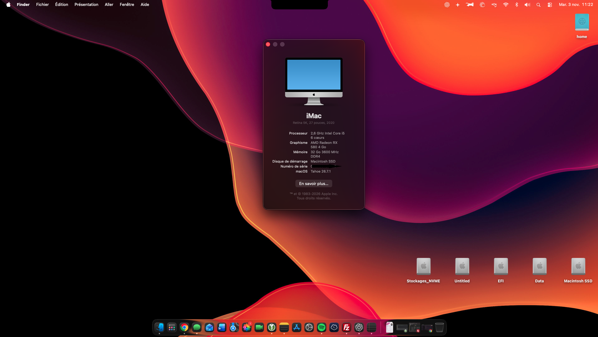

# Hackintosh — ASUS TUF Gaming H570-PRO WIFI

[Français](#français) · [English](#english)



## Français

Configuration personnelle **OpenCore**, utilisée sous **macOS Tahoe 26.7.1**. Aucun problème constaté dans mon utilisation actuelle, avec **VoodooHDA pour l’audio** et le **Wi-Fi privilégié pour le réseau**. L’Ethernet reste désactivé à la suite d’un conflit observé avec les correctifs Wi-Fi.

> Cet EFI est adapté à mon matériel. Il ne constitue pas une configuration universelle. Le dossier EFI seul ne contient pas nécessairement tous les correctifs installés dans macOS.

### Configuration matérielle

| Composant | Modèle |
|---|---|
| Carte mère | ASUS TUF Gaming H570-PRO WIFI |
| Processeur | Intel Core i5-11400F — Rocket Lake |
| Carte graphique macOS | AMD Radeon RX 580 4 Go |
| Seconde carte graphique | NVIDIA GeForce RTX 4060 Ti |
| Wi-Fi / Bluetooth | Fenvi BCM94360CD PCIe |
| Ethernet | Realtek RTL8125 |
| Audio | Realtek S1200A |
| Système | macOS Tahoe 26.7.1 |
| Chargeur de démarrage | OpenCore |
| SMBIOS | iMac20,1 |

### État de fonctionnement

| Élément | État / remarque |
|---|---|
| Démarrage et utilisation courante | Fonctionnels, aucun problème constaté |
| Graphismes | RX 580 utilisée pour macOS |
| RTX 4060 Ti | Non prise en charge par macOS |
| Wi-Fi | Fonctionnel avec les correctifs Broadcom |
| Audio | Fonctionnel avec VoodooHDA-Tahoe |
| Ethernet | Désactivé pour préserver le Wi-Fi |
| Cartographie USB | À documenter et à vérifier |

### Avant de démarrer : créer ses identifiants SMBIOS

L’archive publique a été nettoyée : `SystemSerialNumber`, `MLB` et `SystemUUID` sont vides et `ROM` contient six octets nuls, dans `config.plist` et `oldConfig.plist`. Le modèle `iMac20,1` est conservé. **Ces valeurs doivent être personnalisées avant utilisation.** Le fichier utilisé au démarrage est `EFI/OC/config.plist` ; `oldConfig.plist` est une ancienne configuration.

1. Sauvegarder son EFI fonctionnel et travailler sur une copie, idéalement sur une clé USB de test. Ne pas remplacer les identifiants d’une installation déjà fonctionnelle simplement pour publier son EFI : nettoyer uniquement la copie destinée au partage.
2. Télécharger [GenSMBIOS](https://github.com/corpnewt/GenSMBIOS) depuis son dépôt officiel, extraire l’archive et lancer `GenSMBIOS.command` sous macOS. Python peut être nécessaire selon l’environnement.
3. Dans GenSMBIOS, utiliser l’option **Install/Update MacSerial**, puis **Generate SMBIOS**. Demander le modèle **`iMac20,1`**, correspondant à cette configuration.
4. Ouvrir la copie de `EFI/OC/config.plist` avec un éditeur de plist, par exemple [ProperTree](https://github.com/corpnewt/ProperTree), puis renseigner `PlatformInfo → Generic` :

   | Champ | Valeur à utiliser |
   |---|---|
   | `SystemProductName` | `iMac20,1` |
   | `SystemSerialNumber` | Valeur **Serial** générée |
   | `MLB` | Valeur **Board Serial** générée |
   | `SystemUUID` | Valeur **SmUUID** générée |
   | `ROM` | Une valeur propre à cette installation, de type **Data**, sur **6 octets** |

5. Pour `ROM`, utiliser par exemple l’adresse MAC d’une interface réseau de la machine, sans les séparateurs `:` ou `-`, saisie en hexadécimal dans un champ **Data**. Ne pas la saisir comme une chaîne de texte. Ne pas conserver les six octets nuls de l’archive publique.
6. Vérifier le numéro de série avec le service [Apple — Consulter la couverture](https://checkcoverage.apple.com/). Selon les recommandations Dortania, privilégier un numéro que le service indique comme **non valide** ; si un véritable Mac est reconnu, générer un autre jeu d’identifiants. Ce contrôle ne garantit pas à lui seul l’unicité du numéro.
7. Enregistrer, vérifier les types des champs, puis contrôler le fichier avec la version d’`ocvalidate` correspondant à OpenCore. Tester le démarrage depuis la clé USB avant de remplacer l’EFI principal.
8. Conserver les identifiants générés pour cette installation. Ne pas les partager, les réutiliser sur plusieurs machines ou les régénérer à chaque mise à jour.

> Les services Apple ne sont pas garantis par la seule génération d’un SMBIOS. Ne pas utiliser les identifiants d’un véritable Mac ou ceux publiés par une autre personne.

Références : [GenSMBIOS](https://github.com/corpnewt/GenSMBIOS) · [Dortania — PlatformInfo et ROM](https://dortania.github.io/OpenCore-Install-Guide/config.plist/skylake.html#platforminfo).

### Structure de l’EFI

```text
EFI/
├── BOOT/
│   └── BOOTx64.efi
└── OC/
    ├── ACPI/
    ├── Drivers/
    ├── Kexts/
    ├── Resources/
    ├── OpenCore.efi
    └── config.plist
```

La présence d’un composant dans l’EFI ne signifie pas qu’il est chargé : son activation dépend de `config.plist`.

### Adaptations principales

#### Processeur et SMBIOS

Le Core i5-11400F utilise un **spoof CPUID Rocket Lake vers Comet Lake**, avec la valeur `55060A00`. Le SMBIOS est configuré sur **iMac20,1**.

Référence : [Documentation OpenCore](https://dortania.github.io/docs/latest/Differences.html).

#### Graphismes

La **RX 580 4 Go** est utilisée pour macOS, avec **WhateverGreen**. La **RTX 4060 Ti** ne dispose pas de pilote macOS. La manière dont elle est désactivée ou isolée sous macOS reste à confirmer dans les tables ACPI.

Référence : [Compatibilité NVIDIA — Dortania](https://dortania.github.io/GPU-Buyers-Guide/modern-gpus/nvidia-gpu.html).

#### Wi-Fi et Bluetooth

La **Fenvi BCM94360CD** utilise une pile de compatibilité comprenant notamment :

- `AirportBrcmFixup` ;
- `IOSkywalkFamily` ;
- `IO80211FamilyLegacy` et `AirPortBrcmNIC` ;
- `BlueToolFixup` pour les adaptations Bluetooth.

Ces adaptations accompagnent le retrait du support natif de cette famille de cartes Broadcom depuis Sonoma. Les entrées avec `MinKernel = 24.0.0` restent éligibles sous Tahoe : cette valeur représente une version minimale du noyau.

Référence : [Support Wi-Fi Broadcom — Dortania](https://github.com/dortania/OpenCore-Legacy-Patcher/issues/1076).

#### Ethernet

Le contrôleur intégré est un **Realtek RTL8125**. Dans mes essais, l’activation de l’Ethernet entraîne la perte du Wi-Fi en présence des correctifs `IOSkywalkFamily`, `IO80211FamilyLegacy` et `AirPortBrcmNIC`. J’ai donc choisi de privilégier le Wi-Fi.

Dans l’EFI examiné, `LucyRTL8125Ethernet` est désactivé et `AppleIGC` est activé. Cela ne confirme pas qu’AppleIGC pilote le contrôleur Realtek. La cause exacte du conflit reste à identifier ; il ne s’agit pas d’une incompatibilité générale établie entre Ethernet et Wi-Fi.

#### Audio : VoodooHDA sous Tahoe

Le codec intégré est un **Realtek S1200A**. Pour disposer du son sous Tahoe, j’ai utilisé **VoodooHDA-Tahoe**, proposé par **chris1111**.

Apple a retiré `AppleHDA.kext` de Tahoe. Pour les codecs qui en dépendent, AppleALC seul ne suffit donc plus sans adaptations supplémentaires. Il est plus précis de parler d’une dépendance retirée que d’une incompatibilité totale d’AppleALC avec Tahoe.

L’EFI contient encore **AppleALC** et l’argument `alcid=3`. Cet argument sélectionne une disposition audio pour AppleALC ; il ne configure pas VoodooHDA. Leur présence ne décrit donc pas la solution audio actuellement utilisée.

VoodooHDA est installé dans le système à l’aide de son utilitaire. **L’EFI seul ne représente pas toute la configuration audio.**

Références : [VoodooHDA-Tahoe](https://github.com/chris1111/VoodooHDA-Tahoe) · [AppleALC](https://github.com/acidanthera/AppleALC).

#### USB

`USBInjectAll` et `XhciPortLimit` sont activés. Aucun kext de cartographie USB dédié n’a été identifié lors du premier examen. Des adaptations peuvent être présentes dans `MaLd0n.aml`, dont le contenu reste à analyser.

Référence : [Cartographie USB — Dortania](https://dortania.github.io/OpenCore-Post-Install/usb/manual/manual.html).

### Extensions principales

| Extension | Fonction |
|---|---|
| Lilu | Base de correctifs pour plusieurs extensions |
| VirtualSMC | Émulation du contrôleur SMC |
| WhateverGreen | Correctifs graphiques |
| NVMeFix | Correctifs pour certains SSD NVMe |
| RestrictEvents | Ajustements ciblés du système |
| SMCProcessor / SMCSuperIO | Informations de capteurs |
| AirportBrcmFixup | Correctifs Wi-Fi Broadcom |
| BlueToolFixup | Correctifs Bluetooth |
| AMFIPass | Adaptations des contrôles AMFI |

### Protections système

La configuration réduit certaines protections pour accompagner les adaptations installées :

- certaines fonctions de SIP via `csr-active-config = 03080000` ;
- `SecureBootModel = Disabled` dans OpenCore ;
- chargement d’`AMFIPass`.

Ces paramètres correspondent à cette installation et doivent être réévalués avant toute réutilisation.

### Vérifications restantes

- [ ] Identifier la version exacte d’OpenCore.
- [ ] Valider `config.plist` avec la version correspondante d’`ocvalidate`.
- [ ] Examiner les tables ACPI, notamment `MaLd0n.aml`.
- [ ] Confirmer la gestion de la RTX 4060 Ti sous macOS.
- [ ] Documenter la cartographie USB.
- [ ] Identifier la cause du conflit Ethernet / Wi-Fi.
- [ ] Vérifier l’utilité des composants encore présents dans l’EFI.

### Mon parcours

J’ai commencé le Hackintosh en **2018**, sur un **Acer Iconia 484G64ns**, de Yosemite à Mojave, en passant par Sierra et High Sierra. L’affichage fonctionnait, mais sans accélération graphique matérielle.

J’ai ensuite utilisé un **Lenovo L340-17IRH** équipé d’un **i5-9300H**, de **16 Go de DDR4**, d’un **SSD NVMe de 512 Go** et d’une **Intel AX201 Wi-Fi 6**. Cette installation fonctionnait correctement dans mon utilisation et était régulièrement mise à jour.

Mon PC fixe actuel poursuit cet apprentissage autour d’OpenCore, de la compatibilité matérielle et de la maintenance de macOS sur PC.

---

## English

Personal **OpenCore** configuration running **macOS Tahoe 26.7.1**. No issues observed in my current use, with **VoodooHDA for audio** and **Wi-Fi as the preferred network connection**. Ethernet remains disabled following an observed conflict with the Wi-Fi patches.

> This EFI is tailored to my hardware. It is not a universal configuration. The EFI folder alone does not necessarily include every patch installed in macOS.

### Hardware

| Component | Model |
|---|---|
| Motherboard | ASUS TUF Gaming H570-PRO WIFI |
| CPU | Intel Core i5-11400F — Rocket Lake |
| macOS graphics card | AMD Radeon RX 580 4 GB |
| Secondary graphics card | NVIDIA GeForce RTX 4060 Ti |
| Wi-Fi / Bluetooth | Fenvi BCM94360CD PCIe |
| Ethernet | Realtek RTL8125 |
| Audio | Realtek S1200A |
| Operating system | macOS Tahoe 26.7.1 |
| Bootloader | OpenCore |
| SMBIOS | iMac20,1 |

### Working status

| Feature | Status / notes |
|---|---|
| Boot and everyday use | Working, no issues observed |
| Graphics | RX 580 used for macOS |
| RTX 4060 Ti | Unsupported by macOS |
| Wi-Fi | Working with Broadcom patches |
| Audio | Working with VoodooHDA-Tahoe |
| Ethernet | Disabled to keep Wi-Fi working |
| USB mapping | Needs documentation and verification |

### Before booting: generate your own SMBIOS identifiers

The public archive has been sanitized: `SystemSerialNumber`, `MLB` and `SystemUUID` are empty, and `ROM` contains six zero bytes, in both `config.plist` and `oldConfig.plist`. The `iMac20,1` model is preserved. **Customize these values before use.** The boot configuration is `EFI/OC/config.plist`; `oldConfig.plist` is an older configuration.

1. Back up your working EFI and work on a copy, preferably on a test USB drive. Do not change the identifiers of an existing working installation just to publish its EFI: sanitize only the copy intended for sharing.
2. Download [GenSMBIOS](https://github.com/corpnewt/GenSMBIOS) from its official repository, extract it and run `GenSMBIOS.command` on macOS. Python may be required depending on your environment.
3. In GenSMBIOS, select **Install/Update MacSerial**, then **Generate SMBIOS**. Request **`iMac20,1`**, the model used by this configuration.
4. Open your copy of `EFI/OC/config.plist` using a plist editor such as [ProperTree](https://github.com/corpnewt/ProperTree), and fill in `PlatformInfo → Generic`:

   | Field | Value |
   |---|---|
   | `SystemProductName` | `iMac20,1` |
   | `SystemSerialNumber` | Generated **Serial** |
   | `MLB` | Generated **Board Serial** |
   | `SystemUUID` | Generated **SmUUID** |
   | `ROM` | A value specific to this installation, stored as **Data**, exactly **6 bytes** |

5. For `ROM`, you can use the MAC address of one of the machine’s network interfaces, without `:` or `-` separators, entered as hexadecimal in a **Data** field. Do not store it as a text string. Do not keep the public archive’s six zero bytes.
6. Check the serial with [Apple — Check Coverage](https://checkcoverage.apple.com/). Following Dortania’s guidance, prefer a serial reported as **invalid**; if an actual Mac is recognized, generate a different set of identifiers. This check alone does not guarantee uniqueness.
7. Save, verify field types, and validate the file using the `ocvalidate` version matching OpenCore. Test booting from the USB drive before replacing your main EFI.
8. Keep the generated identifiers for this installation. Do not share them, reuse them across multiple machines or regenerate them with every update.

> Generating SMBIOS identifiers alone does not guarantee Apple services will work. Do not use identifiers belonging to a real Mac or published by someone else.

References: [GenSMBIOS](https://github.com/corpnewt/GenSMBIOS) · [Dortania — PlatformInfo and ROM](https://dortania.github.io/OpenCore-Install-Guide/config.plist/skylake.html#platforminfo).

### EFI structure

```text
EFI/
├── BOOT/
│   └── BOOTx64.efi
└── OC/
    ├── ACPI/
    ├── Drivers/
    ├── Kexts/
    ├── Resources/
    ├── OpenCore.efi
    └── config.plist
```

A component being present in the EFI does not mean it is loaded: its activation depends on `config.plist`.

### Main adaptations

#### CPU and SMBIOS

The Core i5-11400F uses **Rocket Lake to Comet Lake CPUID spoofing**, with the value `55060A00`. The SMBIOS is set to **iMac20,1**.

Reference: [OpenCore documentation](https://dortania.github.io/docs/latest/Differences.html).

#### Graphics

The **RX 580 4 GB** is used for macOS, with **WhateverGreen**. The **RTX 4060 Ti** has no macOS driver. How it is disabled or isolated under macOS still needs to be confirmed by examining the ACPI tables.

Reference: [NVIDIA compatibility — Dortania](https://dortania.github.io/GPU-Buyers-Guide/modern-gpus/nvidia-gpu.html).

#### Wi-Fi and Bluetooth

The **Fenvi BCM94360CD** uses a compatibility stack that includes:

- `AirportBrcmFixup`;
- `IOSkywalkFamily`;
- `IO80211FamilyLegacy` and `AirPortBrcmNIC`;
- `BlueToolFixup` for Bluetooth adjustments.

These adaptations address the removal of native support for this Broadcom card family starting with Sonoma. Entries with `MinKernel = 24.0.0` remain eligible to load on Tahoe: this value specifies a minimum kernel version.

Reference: [Broadcom Wi-Fi support — Dortania](https://github.com/dortania/OpenCore-Legacy-Patcher/issues/1076).

#### Ethernet

The onboard controller is a **Realtek RTL8125**. In my testing, enabling Ethernet causes Wi-Fi to stop working with the `IOSkywalkFamily`, `IO80211FamilyLegacy` and `AirPortBrcmNIC` patches in place. I therefore chose to prioritize Wi-Fi.

In the examined EFI, `LucyRTL8125Ethernet` is disabled and `AppleIGC` is enabled. This does not confirm that AppleIGC drives the Realtek controller. The exact cause of the conflict remains unidentified; this is not an established general incompatibility between Ethernet and Wi-Fi.

#### Audio: VoodooHDA on Tahoe

The onboard codec is a **Realtek S1200A**. To get audio working on Tahoe, I used **VoodooHDA-Tahoe** by **chris1111**.

Apple removed `AppleHDA.kext` from Tahoe. For codecs that depend on it, AppleALC alone is therefore insufficient without additional adaptations. This is more accurately described as a removed dependency than a complete incompatibility between AppleALC and Tahoe.

The EFI still contains **AppleALC** and the `alcid=3` boot argument. This argument selects an audio layout for AppleALC; it does not configure VoodooHDA. Their presence therefore does not describe the audio solution currently in use.

VoodooHDA is installed into the system using its installer. **The EFI alone does not represent the entire audio configuration.**

References: [VoodooHDA-Tahoe](https://github.com/chris1111/VoodooHDA-Tahoe) · [AppleALC](https://github.com/acidanthera/AppleALC).

#### USB

`USBInjectAll` and `XhciPortLimit` are enabled. No dedicated USB mapping kext was identified during the initial review. Adaptations may be included in `MaLd0n.aml`, which still needs analysis.

Reference: [USB mapping — Dortania](https://dortania.github.io/OpenCore-Post-Install/usb/manual/manual.html).

### Main extensions

| Extension | Purpose |
|---|---|
| Lilu | Patching framework used by several extensions |
| VirtualSMC | SMC emulation |
| WhateverGreen | Graphics patches |
| NVMeFix | Fixes for certain NVMe SSDs |
| RestrictEvents | Targeted system adjustments |
| SMCProcessor / SMCSuperIO | Sensor information |
| AirportBrcmFixup | Broadcom Wi-Fi patches |
| BlueToolFixup | Bluetooth patches |
| AMFIPass | AMFI check adjustments |

### System protections

Some protections are reduced to accommodate the installed adaptations:

- certain SIP features through `csr-active-config = 03080000`;
- `SecureBootModel = Disabled` in OpenCore;
- loading of `AMFIPass`.

These settings apply to this installation and should be reassessed before reuse.

### Remaining checks

- [ ] Identify the exact OpenCore version.
- [ ] Validate `config.plist` with the matching version of `ocvalidate`.
- [ ] Examine the ACPI tables, particularly `MaLd0n.aml`.
- [ ] Confirm how the RTX 4060 Ti is handled under macOS.
- [ ] Document USB mapping.
- [ ] Identify the cause of the Ethernet / Wi-Fi conflict.
- [ ] Review whether all components still present in the EFI are needed.

### My journey

I started experimenting with Hackintosh in **2018** on an **Acer Iconia 484G64ns**, running Yosemite through Mojave, including Sierra and High Sierra. Display output worked, but without hardware graphics acceleration.

I later used a **Lenovo L340-17IRH** with an **i5-9300H**, **16 GB DDR4**, a **512 GB NVMe SSD** and **Intel AX201 Wi-Fi 6**. That installation worked well for my use and was regularly updated.

My current desktop continues this learning journey around OpenCore, hardware compatibility and maintaining macOS on PC hardware.

---

## Crédits / Credits

- [Acidanthera](https://github.com/acidanthera) — OpenCore et extensions / OpenCore and extensions.
- [Dortania](https://dortania.github.io/) — Documentation et guides / Documentation and guides.
- [chris1111](https://github.com/chris1111/VoodooHDA-Tahoe) — VoodooHDA-Tahoe.
- Les développeurs des extensions utilisées / The developers of the extensions used.
